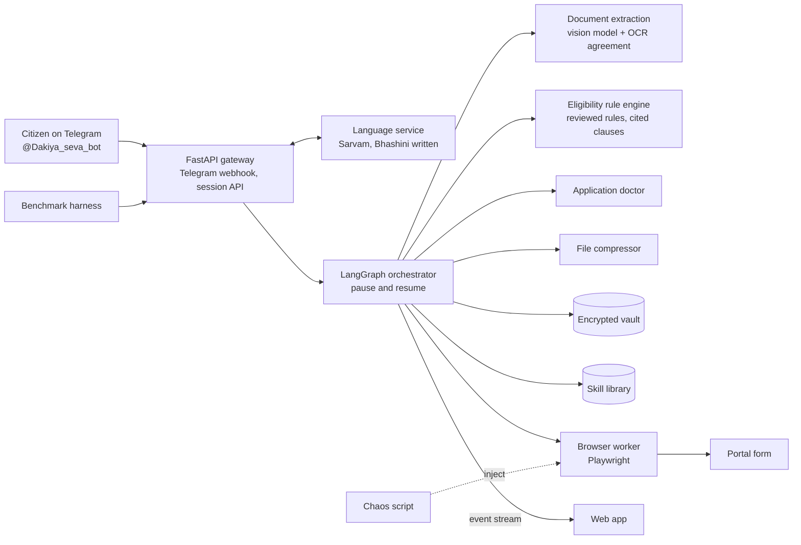

# Dakiya: an agent that applies for scholarships, not one that explains them

Team GradientZero · Forge ’26, Theme 1 (Civic Pulse): Autonomous Public Service and Bureaucracy Execution Agent

Try it on Telegram: [@Dakiya_seva_bot](https://t.me/Dakiya_seva_bot). The API behind it is at
https://api-production-be3b1.up.railway.app. Dakiya is Hindi for the postman.

## The problem

A student can qualify for a scholarship and still never apply. The rules sit inside long
guidelines, portals are in English and ask for registration, Aadhaar and an OTP, upload limits are
not clearly published, and an application can be rejected over a small mismatch between documents
(an initial on one certificate, a full name on another). Chatbots explain schemes, then leave the
student to fight the portal.

## What it does

1. **Ask in your language.** Text in 12 languages. Voice notes go through Sarvam and are tested
   in Tamil.
2. **Find the schemes you qualify for**, each with the official clause quoted. Four schemes have
   reviewed rules today: AICTE Pragati, AICTE Saksham, Tamil Nadu Pudhumai Penn and the Tamil Nadu
   Post-Matric scholarship for BC, MBC and DNC students.
3. **Read your documents.** Marksheet, income and community certificates fill your profile, and
   every field remembers which document it came from. ID numbers are masked where they are found.
4. **Catch rejection risks first.** The application doctor flags name mismatches, expired
   certificates and unreadable or edited ones, with one fix each, in your language.
5. **Fill the portal form** in a real browser. OTPs and CAPTCHAs go to you. They are never solved
   or bypassed.
6. **You press Submit.** The agent stops at the review page. After you approve, it sends a private
   link that works once, for ten minutes, and you press the last button yourself.

## Architecture



The browser service lives in [`browser-product/`](browser-product/README.md) and runs separately.
Each module under [`modules/`](modules/) has its own README.

## What makes it different

- **Code decides, the model reads and writes.** Eligibility is plain Python. A rule loads only
  after a person reviews it and only if each clause appears word for word in the scraped official
  page. No model decides who qualifies.
- **Skills replay and self-repair.** The first run on a portal explores and saves its steps.
  Later runs replay them, and a step whose target moved is found again and re-saved.
- **Confidence that means something.** A field is trusted when the vision model and independent
  OCR (Tesseract) agree, plus a validity check, not when the model says it is sure.
- **A transparent doctor.** A points checklist, not a black-box score. It compares the QR code on a
  Tamil Nadu e-District certificate with its printed number and name.
- **The user holds the last click.** OTP, CAPTCHA, a declaration box and the final Submit all wait
  for the person, and an unclear submit is never retried.

## What is real today, and what is not

- The live bot fills a **public practice form** (Selenium's web form) and a **fictional
  scholarship form** that Pranav hosts. No real government portal has been tested. Real portals
  need permission and an applicant who genuinely qualifies.
- `ALLOW_REAL_SUBMIT` is off in the live bot. With `SUBMIT_LINK=true` the student presses Submit on
  the form's own page.
- Bhashini support is written and unit-tested, but has never run against the real service.
  Sarvam does all speech and translation.
- The benchmark and the chaos script exist, but we have no benchmark numbers yet, so we claim none.
- Free-tier limits are real: calls are paced to the per-minute limit, and when the daily quota
  runs out, document reading fails and the fixed questions take over.

## Results

- Document fields read correctly: 18 of 19, on 3 real certificates. That is a small sample.
- An edited certificate number was caught, because the QR code still held the original. It needs a
  readable QR, so on a blurry photocopy the doctor says it could not verify.
- 700+ automated tests, run with `uv run pytest`. A few need Tesseract installed.

## Guardrails and privacy

- The model never sees OTPs, CAPTCHAs or passwords. For portal steps it sees field names and
  masked page text, never values. It names a field, and the graph types the value locally.
- Aadhaar and bank numbers are masked where the reader finds them. A number it misses could still
  be read, and the bot says so before it starts.
- The vault, uploaded files and LangGraph checkpoints are encrypted.
- Logs hold lengths, field names and timings, not document text or personal values.
- No CAPTCHA, OTP or face-authentication bypass.

## Data sources

| Source | Used for |
| --- | --- |
| myscheme.gov.in (psgs-deg, sak-deg, pudhumai-penn-scheme, pmstn) | scheme eligibility rules |
| bcmbcmw.tn.gov.in/welfschemes.htm | Tamil Nadu post-matric scholarship rules |
| scholarships.gov.in | National Scholarship Portal research |
| Sarvam AI API | speech, translation, text-to-speech |

## Run it locally

```bash
cp .env.example .env
uv sync
uv run pytest
uv run uvicorn --factory app.main:create_app --port 8000
uv run uvicorn modules.language.app:app --port 8081   # language service
```

System packages: `ffmpeg`, `tesseract-ocr`, `tesseract-ocr-tam`.

The bot uses Groq by default, so set `LLM_API_KEY` to a Groq key. To use the free keyless proxy
instead, set `LLM_BASE_URL=http://localhost:8080/v1` and `LLM_MODEL=auto`, then start it in a second
terminal:

```bash
uvx --python 3.12 freellmpool==0.13.0 proxy
```

With `USE_STANDINS=true` the agent uses a fake portal and fake extraction. The fake portal's OTP is
`123456` and its CAPTCHA is `ABCD`.

## Deploy

The image runs the API, plus the freellmpool proxy when `LLM_BASE_URL` points at localhost, and
works on any platform that sets `PORT`. It needs a persistent volume at `/data`, one instance only,
and no scale-to-zero: SQLite and the live event stream live in that instance, and work continues
after the webhook has been answered.

### Railway

To redeploy from this folder:

```bash
railway up --service api
```

To set it up from scratch:

1. Run `railway login`, `railway init --name next-wave` and `railway add --service api`, then
   `railway service link api`.
2. Run `railway volume add --mount-path /data`. From Git Bash, use PowerShell instead, because Git
   Bash rewrites the path.
3. Copy your `.env` into the service's variables, then run `railway domain`.
4. Set `PUBLIC_URL` to that address. With `TELEGRAM_BOT_TOKEN` and `TELEGRAM_WEBHOOK_SECRET` also
   set, the server registers its Telegram webhook when it starts.
5. For WhatsApp, in Meta under WhatsApp > Configuration, set the callback URL to that address plus
   `/whatsapp`, paste `WHATSAPP_VERIFY_TOKEN`, and subscribe to `messages`. The app must be
   published before real messages arrive.

Set `USE_STANDINS=false`, `BROWSER_PRODUCT_URL` and `LANGUAGE_SERVICE_URL` once those services are
up. Back up `VAULT_KEY` somewhere safe: without it the vault cannot be read. The language service
deploys as its own Railway service from `modules/language/Dockerfile`; see its README.

### Region

This API works from any region. The browser service is different: portals may refuse traffic from
outside India, so test them from its region first.

## Session API

Send the `X-API-Key` header with `API_TOKEN` on every call. For the event stream, the browser's
`EventSource` cannot set headers, so use `?key=` instead.

| Call | Purpose |
| --- | --- |
| `POST /session` | Start a session. Pass `{"phone": "91..."}` to link WhatsApp |
| `GET /session/{id}` | Status, paused prompt, masked profile with source tags, filled fields |
| `GET /session/{id}/events` | Live agent events (Server-Sent Events) |
| `GET /session/{id}/audit` | The full audit trail |
| `POST /session/{id}/reply` | Answer a prompt with `{"text": ...}` or `{"button": ...}` |
| `POST /session/{id}/files` | Upload a document |
| `POST /session/{id}/handover` | Helper resumes: `{"action": "resume"}`, `{"action": "abort"}`, or `{"receipt_number": ...}` |

## Safety rules built into the code

- **AI chat:** the model handles the conversation and the basic eligibility details, with ID-shaped
  text masked first. If it fails, the fixed questions take over.
- **Sensitive steps:** OTPs, CAPTCHAs, logins, documents and approval stay in fixed code and never
  reach the model.
- **Portal planning:** the model sees field names and masked page text, never values. It names a
  field and the graph types the value locally.
- **Declaration boxes and drop-downs:** a required box is ticked only after the user says yes in
  chat, and a drop-down is picked by the user unless a stored answer plainly names one option.
- **Final submit:** the model can never press it. It needs the user's approval, and either
  `ALLOW_REAL_SUBMIT=true` or the user pressing it on the one-time link (`SUBMIT_LINK=true`). With
  both off, the agent stops at the review page.
- **Double submit:** a restart can never submit twice. An unclear result goes to a helper.
- **Screenshots:** only sent to a chat when the browser worker marks them masked.

## Team

| Member | Role |
| --- | --- |
| Sanjay Azhagan | Core: Telegram channel, LangGraph orchestrator, vault, skill library |
| Pranav | Browser worker, real-page bridge, human handoff links, hosting |
| Satyajit S | Language service, rule engine, document reading, doctor, compressor, chaos, benchmark |
