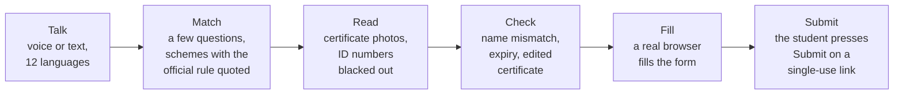
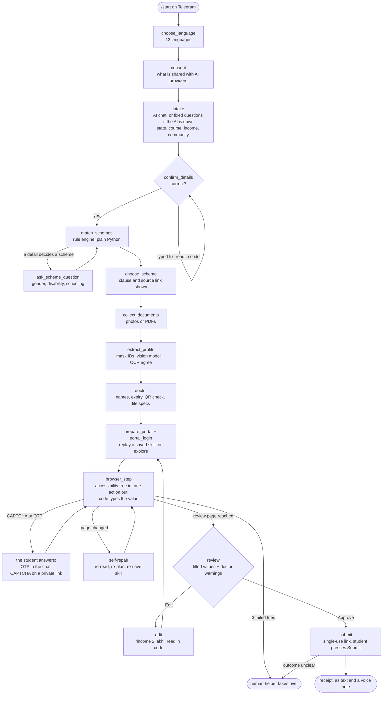
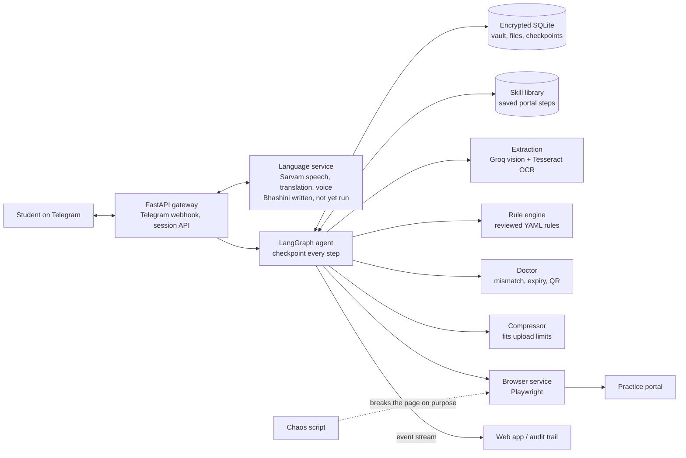

# Dakiya: others explain schemes, we apply for them

**Team GradientZero · Forge '26 · Theme 1, Civic Pulse · Autonomous Public Service and Bureaucracy Execution Agent**

Dakiya is a Telegram agent that finds the government scholarships a student qualifies for, reads
their certificates, catches what a portal would reject, and fills in the application form in a real
browser, in the student's own language, by voice or text. **The student presses Submit, never the AI.**

| | |
| --- | --- |
| **Try the bot** | **[t.me/Dakiya_seva_bot](https://t.me/Dakiya_seva_bot)** (free, no sign-up; pick a language and send a text or voice note) |
| **Demo video** | **[Watch the demo](https://youtube.com/shorts/9FOum4HH87M)** |
| **Pitch deck** | **[Open the slides](https://docs.google.com/presentation/d/1PYdA2geE0mO8BC6-wijWMb3zbrExwRQ3/edit?usp=drive_link)** |
| **Live API** | `https://api-production-be3b1.up.railway.app/health` |

> Today Dakiya fills a **public practice form**, not a live government portal: real portals need
> permission first. Nothing in the demo is submitted to any government site.

---

## The problem

India has hundreds of government schemes, and many students who qualify never apply. The portals
are confusing, English-heavy and unforgiving: one expired certificate or a name that differs
between two documents ("SATYAJIT S" on one, "Satyajit" on another), and the application is
returned. Chatbots can explain a scheme; they leave the student to fight the portal alone.

## What Dakiya does



1. **Talk.** The student picks one of 12 languages and answers by voice note or text. Voice is
   transcribed by Sarvam; Tamil-English mixed speech ("Scholarship apply பண்ணணும்") is handled.
2. **Match.** Dakiya asks only what decides eligibility (state, course, income, community, and
   gender or disability when a scheme depends on it), then lists the schemes the student qualifies
   for, each with the exact clause quoted from the official page and a link to it.
3. **Read.** The student sends photos or PDFs of their marksheet, income and community
   certificates. Aadhaar and bank numbers are blacked out before any AI sees the image.
4. **Check.** The application doctor flags what a portal would reject, with one fix each: names
   that differ between documents, an expired certificate, or a TN e-District certificate whose QR
   code doesn't match its printed number (a sign it was edited).
5. **Fill.** A Playwright browser opens the form and fills it in. OTPs and CAPTCHAs go to the
   student; the AI never sees them. The student reviews the filled values and can correct any by
   typing, such as "income 2 lakh".
6. **Submit.** Dakiya sends a private link that works once. The student checks the form and
   presses Submit. If the outcome is unclear, Dakiya never clicks twice: a human helper checks.

## Technical flow

Every step is a node in a LangGraph state graph, checkpointed after each node. When the agent
needs the student it pauses, and the next Telegram message resumes it exactly there.



### Architecture



## Where the AI is allowed, and where it isn't

| The AI does | Code decides |
| --- | --- |
| Chats to collect four basic details | **Eligibility**: plain Python over YAML rules. A rule loads only if a reviewer signed it off and every clause appears word for word in the saved official page. |
| Reads document photos | **Confidence**: a field counts only when the vision model and independent Tesseract OCR agree, plus a validity check. The model's own opinion doesn't count. |
| Picks the next browser action | **Typing**: the model names a field; code types the value locally. It sees field names and masked page text, never values. |
| | **Final Submit**: the model can never press it. The student does, on a single-use link. |
| | **OTPs, CAPTCHAs, passwords**: never sent to the model. |
| | **Corrections**: "income 2 lakh" or "change dob to 15/08/2005" is parsed in code. |

### Safeguards, enforced in code rather than prompts

- **The user holds the last click.** `ALLOW_REAL_SUBMIT` is off in the live bot. With `SUBMIT_LINK=true` the student presses Submit on the form's own page. A required declaration box is ticked, and a required drop-down picked, only after the student answers in chat.
- **No double submit.** A submit lock survives restarts; an unclear outcome goes to a human helper.
- **Stale actions are refused.** If the page changed since the snapshot, the agent re-reads and re-plans.
- **Three failed tries** on a step hand over to a human, with the reason.
- **Masking before any AI call.** Aadhaar and bank numbers are blacked out with solid boxes,
  after turning the page upright; tested on real documents photographed upside down, sideways and in low quality.
- **Amounts survive translation.** Rupee figures, dates and ID numbers are swapped for placeholders
  before machine translation and restored after.
- **Rate limits.** Every Groq call is paced to the per-minute limit. If the AI is unavailable,
  fixed questions take over and the chat keeps going.
- **Encryption.** The vault, uploaded files and LangGraph checkpoints are encrypted.

## Results so far

| Measure | Result |
| --- | --- |
| Document reading | **94.7%** of fields right (18 of 19) on 3 real certificates: a small sample |
| Problems caught in one live run | 3: name mismatch, expired income certificate, unreadable QR |
| Tampering check | A copy of a real certificate with its number edited was flagged; the genuine copy passed |
| Masking | 12 of 12 tests on real documents (upright, upside down, sideways, low quality): no ID number readable afterwards |
| Schemes | 4, every rule clause matched word for word to the official source |
| Automated tests | 735 in the main project (a few need Tesseract installed) |

**Not proven yet:** a real government portal, self-repair on a broken real page, and speed
against a plain browser agent (the benchmark harness is built but hasn't been run).

### Schemes covered

| Scheme | Key rules | Source |
| --- | --- | --- |
| AICTE Pragati (technical degree) | girls only, family income ≤ ₹8 lakh | [myscheme.gov.in/schemes/psgs-deg](https://www.myscheme.gov.in/schemes/psgs-deg) |
| AICTE Saksham (technical degree) | disability ≥ 40%, family income ≤ ₹8 lakh | [myscheme.gov.in/schemes/sak-deg](https://www.myscheme.gov.in/schemes/sak-deg) |
| Pudhumai Penn (Tamil Nadu) | girls, TN resident, Class 6 to 12 in TN government schools | [myscheme.gov.in/schemes/pudhumai-penn-scheme](https://www.myscheme.gov.in/schemes/pudhumai-penn-scheme) |
| TN Post Matric (BC, MBC, DNC) | TN resident, BC / MBC / DNC, parental income ≤ ₹2.5 lakh | [bcmbcmw.tn.gov.in](https://bcmbcmw.tn.gov.in/welfschemes.htm) |

## Tech stack

Python 3.12 · FastAPI · LangGraph · Playwright · SQLite (encrypted) · Docker · Railway ·
Telegram Bot API · **Groq** (`qwen/qwen3.8-27b`, text and vision) · **Sarvam AI** (speech-to-text,
translation, text-to-speech; Bhashini support written but never run against the real service) · Tesseract OCR · OpenCV

## Repository layout

| Path | What it is |
| --- | --- |
| [`app/`](app/) | The agent core: FastAPI gateway, Telegram channel, LangGraph graph (`app/graph/`), vault, skill library, session API |
| [`contracts/`](contracts/) | Shared Pydantic interfaces between the core, the modules and the browser service |
| [`modules/extraction/`](modules/extraction/) | Document reading: masking, OCR, vision model, confidence |
| [`modules/rules/`](modules/rules/) | Eligibility rule engine, reviewed rule files and the official page snapshots they cite |
| [`modules/doctor/`](modules/doctor/) | Application doctor: mismatches, expiry, QR tampering check, readable fixes in the chat's language |
| [`modules/language/`](modules/language/) | Language service (speech, translation, voice), its Dockerfile and Railway config |
| [`modules/compressor/`](modules/compressor/) | Fits uploads to a portal's size and format limits |
| [`modules/chaos/`](modules/chaos/) | Chaos script that breaks a form page on purpose to test self-repair |
| [`modules/bench/`](modules/bench/) | Benchmark harness against the session API (not yet run on a real portal) |
| [`browser-product/`](browser-product/) | The Playwright browser service, private Submit/CAPTCHA links and human handoff |
| [`common/`](common/) | Shared helpers: LLM client, pacing, text normalisation, corrections |
| [`tests/`](tests/) | Automated tests for the core and modules |
| [`docs/`](docs/) | Integration guide and design notes |

Each module folder has its own README with the details.

## Run it locally

```bash
cp .env.example .env      # fill in the keys you have
uv sync
uv run pytest             # 735 tests; live tests skip without keys, a few need Tesseract
uv run uvicorn --factory app.main:create_app --port 8000
```

System packages: `ffmpeg`, `tesseract-ocr`, `tesseract-ocr-tam`. The bot uses Groq by default,
so set `LLM_API_KEY` to a Groq key (or use the keyless proxy:
`LLM_BASE_URL=http://localhost:8080/v1`, `LLM_MODEL=auto`, then
`uvx --python 3.12 freellmpool==0.13.0 proxy`). With `USE_STANDINS=true` the agent uses a fake
portal and fake extraction; the fake portal's OTP is `123456` and its CAPTCHA is `ABCD`.

The language service runs separately (`uv run uvicorn modules.language.app:app --port 8081`,
needs `SARVAM_API_KEY`); point the core at it with `LANGUAGE_SERVICE_URL`. The browser service
is in [`browser-product/`](browser-product/README.md); see [`docs/INTEGRATION.md`](docs/INTEGRATION.md)
for how the parts connect, and `uv run python -m scripts.check_integration` to check them.

## Deploy

The image runs the API, plus the freellmpool proxy when `LLM_BASE_URL` points at localhost, and
works on any platform that sets `PORT`. It needs a persistent volume at `/data`, one instance only,
and no scale-to-zero: SQLite and the live event stream live in that instance.

On Railway (live at `https://api-production-be3b1.up.railway.app`), redeploy with
`railway up --service api`. To set up from scratch: `railway login`, `railway init --name next-wave`,
`railway add --service api`, `railway service link api`, `railway volume add --mount-path /data`,
copy `.env` into the service variables, run `railway domain`, and set `PUBLIC_URL` to that
address. With `TELEGRAM_BOT_TOKEN` and `TELEGRAM_WEBHOOK_SECRET` set, the server registers its
Telegram webhook on start. Set `USE_STANDINS=false`, `BROWSER_WORKER_URL` and
`LANGUAGE_SERVICE_URL` once those services are up, and back up `VAULT_KEY`: without it the vault
can't be read. The language service deploys as its own Railway service; see
[`modules/language/README.md`](modules/language/README.md#deploy-on-railway-next-to-the-core-api).

Portals may refuse traffic from outside India, so test the browser service from its region first.

## Session API

Send `X-API-Key: <API_TOKEN>` on every call (the event stream also accepts `?key=`).

| Call | Purpose |
| --- | --- |
| `POST /session` | Start a session |
| `GET /session/{id}` | Status, paused prompt, masked profile with source tags, filled fields |
| `GET /session/{id}/events` | Live agent events (Server-Sent Events) |
| `GET /session/{id}/audit` | The full audit trail |
| `POST /session/{id}/reply` | Answer a prompt with `{"text": ...}` or `{"button": ...}` |
| `POST /session/{id}/files` | Upload a document |
| `POST /session/{id}/handover` | Helper resumes: `{"action": "resume"}`, `{"action": "abort"}`, or `{"receipt_number": ...}` |

## Privacy

The bot says so before starting: chat text and document photos are processed by AI providers.
Aadhaar and bank numbers are blacked out where the reader finds them, though a number it misses
could still be read. OTPs, CAPTCHAs and passwords never reach a model. Data at rest is encrypted.
No personal documents are stored in this repository.

## Team GradientZero

| Member | Built |
| --- | --- |
| Sanjay Azhagan | Agent core, LangGraph flow, Telegram channel, vault, integration |
| Pranav | Browser service, private Submit and CAPTCHA links, human handoff, hosting |
| Satyajit S | Language service, rule engine, document reading, doctor, compressor, chaos script, benchmark |
