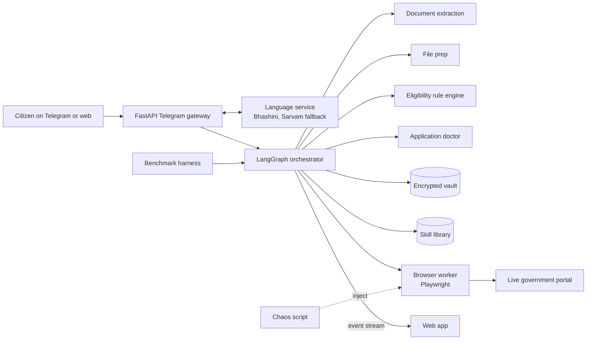

# GradientZero: remote modules implementation plan

Owner: Satyajit (remote teammate). Window: Sat 31 Oct, 8:15 AM to 2:00 PM IST.
Project: Forge '26 buildathon, Theme 1, autonomous public service agent.
Channel: **Telegram bot** (replaces WhatsApp everywhere).

This file is written to be fed to Claude Code. Save it in the repo as
`docs/remote_modules_plan.md` and work through it one phase at a time.

---

## 0. How to run this with Claude Code

### Working mode: keep going, ask only when blocked

- Work through the phases in order without waiting for approval between them.
- **Ask Satyajit only when you can't continue without the answer.** Examples: the GitHub repo URL when you're ready to push; an API key for a live test; a portal's exact URL or file limits; the agent event format if no teammate branch defines it.
- When you ask, do it in one short message listing everything you need at that point. Then **keep working on whatever doesn't depend on the answer** (the next phase, tests, docs) instead of waiting.
- If an answer never comes, finish the phase with a clear `TODO(satyajit): <what's needed>` in the code and the PR description, and move on. Never fill the gap with invented data.

### Repo and branch

- **If the repo URL isn't available yet:** `git init` a local repo, create the branch `feat/remote-modules`, and build everything there. Once Satyajit gives the URL, add it as `origin`, fetch, rebase onto `origin/main`, and push.
- **All my work goes on one branch: `feat/remote-modules`**, with one commit per phase (e.g. `phase 1: document extraction`). Open a single PR to `main` when Phase 8 is done, or earlier if a teammate needs a module merged.
- **Stay consistent with the other two branches.** When the remote is available, run `git fetch --all` and read the core teammate's and browser teammate's branches before writing code:
  - Match their Python version, package manager, formatter and linter config, folder layout, and naming style.
  - If `contracts/` exists on any branch, use it and extend it. Never rename or remove fields they use.
  - If their agent event format, session API or `/inject` endpoint is defined, build `modules/bench/client.py` and `chaos.js` against that definition instead of the assumed shapes in Phases 6 and 7.
  - Where their conventions differ from this plan, follow theirs for anything shared (contracts, layout, tooling) and this plan for module internals. List every difference in the PR description.
  - Re-fetch before each push and rebase if `main` moved.

### Portals (decided)

Use these two portals for now. Satyajit will update this if it changes.

| portal_id | Portal | Notes |
|---|---|---|
| `nsp` | National Scholarship Portal | Central schemes |
| `tn_scholarship` | Tamil Nadu state scholarship portal | Ask Satyajit for the exact URL when Phase 3 or 4 needs it |

### Prompt template for each phase

```
Read docs/remote_modules_plan.md, sections 0 to 4 and Phase <N>.
Implement Phase <N> exactly as specified. Follow the working mode in section 0
and the ground rules in section 2.
Before writing any client for an external API, fetch the docs URL given in the phase
and follow the current request/response shapes.
Run the phase's tests and acceptance checks. Fix failures.
Commit on feat/remote-modules as "phase <N>: <module>". Push if origin exists.
Print a 5-line summary (built, tests, open TODOs, anything I must check),
then continue to the next phase unless you're blocked.
```

Or run everything with one prompt: "Read docs/remote_modules_plan.md and implement Phases 0 to 8 in order, following section 0's working mode."

Phase order and time boxes:

All phases are committed on the one branch `feat/remote-modules`.

| Phase | Module | Time box | Hard finish |
|---|---|---|---|
| 0 | Foundation: contracts, LLM wrapper, fixtures layout | 8:15 to 8:30 | 8:30 |
| 1 | M1 document extraction | 8:30 to 9:50 | 9:50 |
| (sync call) | | 10:00 | |
| 2 | M2 language service | 10:00 to 10:50 | 10:50 |
| 3 | M3 file compressor and resizer | 10:50 to 11:25 | 11:25 |
| 4 | M4 eligibility rule engine | 11:25 to 12:30 | 12:30 |
| 5 | M5 application doctor | 12:30 to 1:05 | 1:05 |
| 6 | M6 chaos script | 1:05 to 1:30 | 1:30 |
| 7 | M7 benchmark skeleton | 1:30 to 1:45 | 1:45 |
| 8 | Submission drafts | 1:45 to 2:00 | 2:00 |

If a phase overruns by more than 10 minutes, apply its "cut first" list and move on.

---

## 1. Context

**What the product does.** A citizen sends a Tamil voice note to our Telegram bot ("Scholarship apply pannanum"). The agent:
1. Asks 4 quick questions and finds the schemes they qualify for, using rules taken from official guidelines and citing the clause.
2. Reads photos of their documents, prepares the files to the portal's limits, and runs an "application doctor" to catch rejection risks.
3. Logs in to the real government portal and fills the form with a browser agent. The agent replays saved skills and repairs itself when the page changes. It hands CAPTCHA, OTP and the final approval to the human on Telegram.
4. Submits only after approval, returns the receipt in Tamil, and can watch the application status afterwards.

**Who owns what.**
- Core teammate (on campus): FastAPI Telegram gateway, LangGraph orchestrator, pause/resume, skill library, vault.
- Browser teammate (on campus): Playwright browser worker, portal flows, login, `/inject` endpoint, web app, deployment, demo video.
- **Me (remote): the modules in this file.** They must work standalone, be importable as Python packages or run as a Docker service, and never need the agent running.

**The hackathon.** Forge '26 is NxtWave's Gen AI buildathon for IIT, NIT, IIIT and BITS students. We're Team GradientZero, Theme 1 (Civic Pulse, Digital Governance and Public Information), problem "Autonomous Public Service and Bureaucracy Execution Agent". Submissions close Sun 1 Nov, 11:59 PM IST; the team target is 10 PM. The top 10 teams present at a finale.

**Judging rubric (100 points)**, which decides what to polish:
- Live demo and robustness, 30: runs live without crashing, and handles bad input, missing data and network problems gracefully.
- AI reasoning and agentic execution, 25: multi-step planning, tool calls, error recovery, self-correction, low hallucination, source attribution.
- Problem relevance, impact and USP, 25: real value for citizens, and clear differentiation from chatbots.
- Technical depth, 20: clean, modular code; real engineering (RAG, browser automation loops, state graphs), not API wrappers.

**What the team submits:** problem statement and solution description (with technical architecture), a live hosted app URL, a 2 to 3 minute demo video of a real end-to-end run, a public GitHub repo with a clean README, setup steps and an architecture diagram, and a 5 to 7 slide deck. My Phase 8 drafts feed all of these except the live app and the video recording.

**Grounds for disqualification:** fake, static or hardcoded mock data in place of live backends; code from before the event or copied from another team; pre-recorded demos passed off as live.

**Things this plan can't know yet.** Ask Satyajit when you reach the step that needs them, following section 0's working mode. Never guess: the GitHub repo URL; the team's LLM provider and keys (set in `.env`); the Tamil Nadu portal's exact URL and both portals' file limits; and whether `contracts/` or the agent event format already exist on a teammate's branch.

**Hackathon rules that constrain the code.**
- No dummy or hardcoded data in anything the demo runs. Real APIs, real official datasets, real documents only. Test doubles are allowed only inside `tests/` and in the benchmark's stub server, which must be labelled test-only.
- The repo is public at submission. No personal documents, no keys.
- Every teammate must be able to explain every module, so keep the code readable and documented.

---

## 2. Ground rules for Claude Code

1. Python 3.11, Pydantic v2, FastAPI, pytest. Type hints everywhere. Short docstrings.
2. Each module lives in `modules/<name>/` with its own `requirements.txt`, `README.md` and `tests/`.
3. A module may import only from `contracts/`, `common/` and itself. Never import from `gateway/`, `orchestrator/`, `browser_worker/` or `webapp/`, and never edit files there. Those belong to teammates.
4. If `contracts/` already exists (the core teammate may have committed it at midnight), **extend it, don't rewrite it.** Add missing models in new files or append to existing ones, and keep existing names.
5. Secrets come only from environment variables. Commit `.env.example`, never `.env`.
6. `fixtures/` is git-ignored. Real documents, voice notes, ground truth and personal profiles live there. Tests that need fixtures must `pytest.skip` when the folder is missing, so CI on the public repo still passes.
7. Never output, log or save a full Aadhaar number or bank account number. Keep only the last 4 digits.
8. Every LLM call goes through `common/llm.py`, which logs model, tokens, latency and caller to `logs/llm.jsonl`. Never log document text or personal values. Lengths and field names only.
9. Before writing a client for any external API (Bhashini, Sarvam, Telegram, browser-use), fetch the docs URL given in the phase and use the current shapes. Do not rely on memory for endpoints.
10. Pin dependency versions in each `requirements.txt`.
11. No mock data in runtime paths. If something is missing at runtime (no portal spec, no reviewed rules), raise a clear error. Never invent a fallback value.

---

## 3. Repo layout (my part only)

```
contracts/
  __init__.py
  profile.py          FIELD_KEYS, FieldValue, Profile, ExtractedDocument, Quality
  portal.py           DocSpec, PortalSpec, PreparedFile
  eligibility.py      Clause, RuleResult, SchemeMatch, Question
  doctor.py           Finding, Diagnosis
  portals/            <portal_id>.json, filled from the browser teammate's research sheet
common/
  llm.py              LiteLLM wrapper: vision_json(), text_json(), logging
  textnorm.py         shared normalisers (names, amounts, dates)
modules/
  extraction/         preprocess.py, classify.py, schemas.py, prompts.py, ocr.py,
                      confidence.py, validators.py, mask.py, extract.py, merge.py, cli.py, tests/
  language/           app.py, router.py, providers/bhashini.py, providers/sarvam.py,
                      audio.py, protect.py, media.py, Dockerfile, README.md, tests/
  fileprep/           prepare.py, legibility.py, cli.py, tests/
  eligibility/        scrape.py, draft_rules.py, loader.py, engine.py, questions.py,
                      explain.py, cli.py, tests/
  doctor/             names.py, checks.py, diagnose.py, messages.py, cli.py, tests/
  chaos/              chaos.js, test_form.html, run_local.py, README.md
  bench/              bench.py, client.py, baseline_browser_use.py, report.py,
                      stub_server.py (TEST ONLY), README.md
data/schemes/
  sources.yaml        which schemes and which official URLs
  raw/<scheme_id>/    scraped HTML/PDF/text + meta.json (url, scraped_at, sha256)
  rules/<scheme_id>.yaml   reviewed rules (engine loads only reviewed files)
docs/
  remote_modules_plan.md (this file), architecture.mmd, readme_draft.md,
  deck_text.md, video_script.md, submission_form.md
fixtures/            (git-ignored) docs/, ground_truth/, voice/, profiles/
logs/                (git-ignored)
```

Add to `.gitignore`: `fixtures/`, `logs/`, `.env`, `work/`, `media/`. Commit `results/*.csv` only from real runs, never from the stub.

---

## 4. Environment variables (`.env.example`)

```
# LLM (one provider for vision + text, via LiteLLM model strings)
VISION_MODEL=gemini/gemini-2.5-flash        # or openai/gpt-4o, anthropic/claude-..., decided at sync
TEXT_MODEL=gemini/gemini-2.5-flash
GEMINI_API_KEY=
OPENAI_API_KEY=
ANTHROPIC_API_KEY=

# Language providers
BHASHINI_USER_ID=
BHASHINI_ULCA_API_KEY=
BHASHINI_PIPELINE_ID=                       # from Bhashini docs
SARVAM_API_KEY=
LANG_PRIMARY=bhashini                       # bhashini | sarvam
STT_PRIMARY=                                # optional override for speech-to-text only
PROVIDER_TIMEOUT_S=5
MEDIA_DIR=./media
PUBLIC_BASE_URL=http://localhost:8081       # used to build audio_url

# Working dirs
WORK_DIR=./work
LOG_DIR=./logs

# Benchmark
AGENT_URL=http://localhost:8000
WORKER_URL=http://localhost:8001
```

Model names above are examples. Use whatever the team agreed, set through env only.

---

## Phase 0: Foundation (8:15 to 8:30)

**Goal:** shared models and the LLM wrapper exist so every later phase can import them.

### 0.1 `contracts/` (extend if it exists)

```python
# contracts/profile.py
from datetime import date
from typing import Literal
from pydantic import BaseModel, Field

FIELD_KEYS = [
    "full_name", "dob", "gender", "father_name", "mother_name",
    "category", "annual_family_income", "state", "district",
    "course", "year_of_study", "institution", "marks_percent", "exam_year",
    "certificate_number", "issue_date", "aadhaar_last4", "bank_ifsc",
]

DocType = Literal["marksheet", "income_certificate", "community_certificate", "other"]

class FieldValue(BaseModel):
    value: str | int | float | date | None
    source_doc: str                 # doc_id, or "voice", or "user_typed"
    confidence: float = Field(ge=0, le=1)
    bbox: list[float] | None = None # x, y, w, h in pixels on the cleaned image
    evidence: str | None = None     # printed text the value was read from (masked)
    verified: bool = False

class Profile(BaseModel):
    fields: dict[str, FieldValue] = {}

class Quality(BaseModel):
    blur_score: float
    brightness: float
    skew_deg: float
    too_blurry: bool
    too_dark: bool

class ExtractedDocument(BaseModel):
    doc_id: str
    doc_type: DocType
    fields: dict[str, FieldValue]
    file_ref: str                   # path to the cleaned, masked image
    page_count: int = 1
    quality: Quality
```

```python
# contracts/portal.py
from typing import Literal
from pydantic import BaseModel

FileType = Literal["jpg", "jpeg", "png", "pdf"]

class DocSpec(BaseModel):
    doc_type: str
    accepted_types: list[FileType]
    max_kb: int
    min_kb: int | None = None
    max_px: tuple[int, int] | None = None   # (width, height)
    source_note: str | None = None          # where this limit came from

class PortalSpec(BaseModel):
    portal_id: str
    name: str
    documents: list[DocSpec]

class PreparedFile(BaseModel):
    path: str
    mime: str
    size_kb: float
    px: tuple[int, int] | None
    pages: int
    actions: list[str]          # human-readable, shown in the web app
    legible: bool
    words_before: int | None
    words_after: int | None
```

```python
# contracts/eligibility.py
from datetime import date
from typing import Literal
from pydantic import BaseModel

class Clause(BaseModel):
    text: str
    source_url: str
    scraped_at: date

class RuleResult(BaseModel):
    rule_id: str
    field: str
    status: Literal["pass", "fail", "unknown"]
    expected: str
    actual: str | None
    clause: Clause

class SchemeMatch(BaseModel):
    scheme_id: str
    name: str
    portal_id: str
    status: Literal["eligible", "not_eligible", "needs_info"]
    results: list[RuleResult]
    benefit_inr: int | None
    benefit_text: str | None
    deadline: date | None
    required_docs: list[str]

class Question(BaseModel):
    field: str
    text_en: str
    choices: list[str] | None = None   # rendered as Telegram inline buttons
```

```python
# contracts/doctor.py
from typing import Literal
from pydantic import BaseModel
from .eligibility import SchemeMatch

class Finding(BaseModel):
    check: str            # e.g. "name_consistency"
    kind: Literal["mismatch", "eligibility", "missing_doc", "file_spec", "quality", "validity"]
    field: str | None
    severity: Literal["blocker", "high", "medium", "low"]
    points: int
    detail: str
    values_by_doc: dict[str, str] = {}
    fix: str              # one action sentence in English

class Diagnosis(BaseModel):
    scheme_id: str
    risk_score: int       # 0 to 100
    band: Literal["low", "medium", "high", "blocked"]
    findings: list[Finding]
    eligibility: SchemeMatch | None
```

### 0.2 `common/llm.py`

- Use `litellm`.
- `vision_json(images: list[bytes], prompt: str, schema: type[BaseModel], caller: str) -> BaseModel`. It sends the images as base64 data URLs with the prompt, requests JSON that matches `schema.model_json_schema()` (use the provider's structured-output or JSON mode through LiteLLM's `response_format`), and validates with Pydantic. On a validation error, retry once with the error appended to the prompt.
- `text_json(prompt: str, schema, caller) -> BaseModel` works the same way without images.
- Log one JSON line per call to `logs/llm.jsonl`: ts, caller, model, prompt_tokens, completion_tokens, latency_ms, ok. No content.
- Expose a counter `llm_calls_total()` for the benchmark.

### 0.3 `common/textnorm.py`

- `norm_text(s)`: casefold, NFKC, strip punctuation except `/` and `-`, collapse whitespace.
- `norm_amount(s) -> int | None`: handles "Rs. 2,50,000/-", "₹250000", "2.5 lakh", "Two Lakh Fifty Thousand" (words optional; skip words if time is short).
- `norm_date(s) -> date | None`: dd/mm/yyyy, dd-mm-yyyy, dd.mm.yyyy, yyyy-mm-dd, "15 Aug 2005". Indian day-first order.

### 0.4 Fixtures layout (git-ignored, filled by hand)

```
fixtures/docs/<person>_<doctype>[_n].jpg|pdf
fixtures/ground_truth/<same stem>.json   {"doc_type": "...", "fields": {"full_name": "...", ...}}
fixtures/voice/<n>_<label>.ogg           Telegram voice notes (forward to yourself, download)
fixtures/profiles/<person>.json          a Profile JSON for engine/doctor tests
```

**Acceptance:** `python -c "import contracts, common.llm"` works; `pytest contracts` (a tiny model round-trip test) passes; one live `vision_json` call on a fixture image returns valid JSON.

---

## Phase 1: M1 document extraction (8:30 to 9:50)

**Goal:** phone photos of Indian certificates become `ExtractedDocument` objects with confidence you can trust. Confidence comes from **agreement between the vision LLM and independent OCR**, not from the model's own opinion.

**Install:** `opencv-python-headless`, `pillow`, `pillow-heif`, `pypdfium2`, `pytesseract`, `rapidfuzz`, `numpy`, `litellm`. System packages: `tesseract-ocr tesseract-ocr-tam` (apt). Use Tesseract as the OCR engine; PaddleOCR is optional and only if time remains, because its install is slow.

### Public API

```python
def extract(paths: list[Path], doc_type: DocType | None = None, doc_id: str | None = None) -> ExtractedDocument
def merge_profile(docs: list[ExtractedDocument], prior: Profile | None = None) -> Profile
```

Multiple paths are pages of the same document.

### Steps

1. **`preprocess.load_pages(path)`**: open with PIL, apply `ImageOps.exif_transpose`, register `pillow_heif` for HEIC, and convert to RGB numpy arrays. For PDF, render each page with `pypdfium2` at scale 200/72.
2. **`preprocess.quality(img) -> Quality`**: grayscale, resize to 1000 px wide, `blur_score = cv2.Laplacian(gray, CV_64F).var()`, `brightness = gray.mean()`. Thresholds go in constants: `too_blurry = blur_score < 60`, `too_dark = brightness < 60`. Tune both on the fixtures and note the final values in the README.
3. **`preprocess.find_document(img)`**: downscale to 800 px high for detection, then GaussianBlur 5x5, Canny(50, 150), dilate once, and `findContours`. Take the largest contours by area and `approxPolyDP(0.02 * perimeter)`. The first 4-point contour covering more than 25% of the image gets a four-point perspective transform on the full-resolution image. Otherwise return the original.
4. **`preprocess.deskew(img)`**: Otsu threshold (inverted), take the text pixel coordinates, `cv2.minAreaRect`, and rotate when 0.5° < |angle| < 15°. Record `skew_deg`.
5. **`mask.redact(img, ocr_words) -> (img, last4s)`**: find 12-digit Aadhaar patterns (`\d{4}\s?\d{4}\s?\d{4}`, including ones split across adjacent OCR words) and bank account numbers (9 to 18 digits near the words A/c, Account or SB). Blur those boxes with GaussianBlur(51, 51) and return the last 4 digits only. Run this **before** saving `file_ref` and before any LLM call, so the LLM never sees a full number.
6. Save the cleaned, masked image to `WORK_DIR/<doc_id>.jpg` at quality 92 as `file_ref`.
7. **`classify.classify(img) -> DocType`**: only when `doc_type` is None. One `vision_json` call with an enum schema.
8. **`schemas.py`**: one Pydantic schema per document type. Each field returns `{value, evidence}`, where evidence is the exact printed text the value was read from.
   - marksheet: full_name, father_name?, institution, course, year_of_study?, marks_percent (or total and max, from which you compute it), exam_year
   - income_certificate: full_name, father_name, annual_family_income, district, state, certificate_number, issue_date
   - community_certificate: full_name, father_name, category, district, state, certificate_number, issue_date
9. **`prompts.py`**: system prompt:
   "You read Indian government and academic documents, often bilingual Tamil and English. Return only values printed on the document. If a field is not printed, return null. Never infer or guess. Copy names exactly as printed, including initials. Dates as YYYY-MM-DD. Income as an integer number of rupees per year. For each field also return `evidence`: the exact printed text you read it from."
   Add one line per document type describing where its fields usually sit.
10. **`ocr.read(img) -> list[OcrWord]`**: `pytesseract.image_to_data(img, lang="eng+tam", output_type=DICT)`. Keep words with conf > 30 and group them into lines (block, par, line numbers) with their union boxes.
11. **`confidence.score(field, value, evidence, lines) -> (conf, bbox)`**:
    - `agreement = max(fuzz.partial_ratio(norm_text(evidence or str(value)), norm_text(line.text)) for line in lines) / 100`. Also try windows of 2 consecutive lines, for values that wrap.
    - `valid = 1.0 if validators.check(field, value) else 0.0`
    - `conf = 0.6 * agreement + 0.4 * valid`; a null value gets conf 0.
    - bbox = the best-matching line's box.
12. **`validators.check(field, value)`**:
    - full_name, father_name: letters, spaces, dots only; 2 to 60 characters.
    - dob: parses, and the age is between 14 and 60.
    - marks_percent: 0 to 100.
    - annual_family_income: an integer from 0 to 1e8.
    - category: one of `SC, SCA, ST, BC, BCM, MBC, DNC, OBC, EWS, OC, GEN`. Map long forms, e.g. "Backward Class" becomes BC, "Most Backward Class" becomes MBC.
    - issue_date: parses, is not in the future, and is after 2000.
13. **Retry pass:** for any field with conf < 0.6 that has a bbox, crop its region with 40 px padding, upscale 2x, and ask `vision_json` for that single field. Keep whichever value has the higher conf. If time is short, skip this step.
14. **`extract()`** assembles the `ExtractedDocument`. Each `FieldValue` gets `source_doc=doc_id`, its conf, bbox and evidence (masked).
15. **`merge.merge_profile()`**: per field, keep the highest-confidence value. Never overwrite a field the user marked `verified`. Conflicts are left for the doctor (M5).
16. **`cli.py`**: `python -m modules.extraction.cli fixtures/docs/a_marksheet.jpg [--type marksheet]` prints the JSON.

### Tests

- `test_validators.py`: pure unit tests.
- `test_preprocess.py`: build a synthetic page with `cv2.putText`, rotate it 7°, and check that deskew brings it within 1°. Synthetic images are fine for unit tests.
- `test_mask.py`: synthetic image containing "1234 5678 9012"; after redact, OCR on the output contains no 12-digit run, and last4 is "9012".
- `test_accuracy.py` (skips without fixtures): run `extract` on every fixture that has ground truth, compute field-level exact-match accuracy (after `norm_text`), and write `reports/extraction_accuracy.json` with per-type and overall numbers. Assert that no output contains a 12-digit run.

### Acceptance

- [ ] All three document types extract from real phone photos
- [ ] `reports/extraction_accuracy.json` exists; put the overall number in the module README for the deck
- [ ] Under 15 seconds per document (log it)
- [ ] No full Aadhaar or bank number in outputs, logs or saved images
- [ ] Committed on feat/remote-modules by 9:50 (core teammate needs this first; push as soon as the repo is available)

**Cut first:** retry pass (step 13), then the classifier (require `doc_type`), then HEIC support.

---

## Phase 2: M2 language service (10:00 to 10:50)

**Goal:** a FastAPI service in Docker that the Telegram gateway calls for every voice turn. It tries Bhashini first and falls back to Sarvam automatically.

**Docs to fetch first:**
- Bhashini: https://bhashini.gitbook.io/bhashini-apis/ (pipeline config, then compute)
- Sarvam: https://docs.sarvam.ai/api-reference/introduction/llms.txt and https://docs.sarvam.ai/api/getting-started/models.md
- Telegram, for audio formats: https://core.telegram.org/bots/api#sendvoice

### Telegram-specific facts to design around

- Telegram voice notes arrive as OGG/Opus. The gateway downloads them through `getFile` and sends the **bytes (base64)** to this service. Never pass a Telegram file URL to this service, because those URLs contain the bot token.
- To show as a voice note, `sendVoice` needs OGG encoded with Opus. So `/tts` returns OGG/Opus.

### Endpoints

| Method and path | Request | Response |
|---|---|---|
| POST /stt | `{audio_b64, mime="audio/ogg", lang="ta", also_english=false}` | `{text, lang, english?, provider, latency_ms}` |
| POST /translate | `{text, src, tgt, keep: [str]}` | `{text, provider, latency_ms}` |
| POST /tts | `{text, lang="ta", voice?: str}` | `{audio_url, media_id, duration_s, provider}` |
| GET /media/{media_id}.ogg | | audio/ogg file |
| GET /health | | `{bhashini: {ok, last_latency_ms}, sarvam: {...}}` |

### Steps

1. **`audio.py`** (ffmpeg through subprocess pipes):
   - `to_wav16k(b: bytes) -> bytes`: `ffmpeg -hide_banner -loglevel error -i pipe:0 -ac 1 -ar 16000 -f wav pipe:1`
   - `to_ogg_opus(b: bytes) -> bytes`: `ffmpeg ... -i pipe:0 -c:a libopus -b:a 32k -f ogg pipe:1`
   - `duration_s(wav: bytes) -> float` from the WAV header.
2. **Provider interface** in `providers/base.py`: `async stt(wav: bytes, lang) -> str`, `async translate(text, src, tgt) -> str`, `async tts(text, lang, voice) -> bytes`. Use `httpx.AsyncClient` with timeout `PROVIDER_TIMEOUT_S`.
3. **`providers/bhashini.py`**: follow the fetched docs. The expected shape is: (a) a pipeline config call with `userID` and `ulcaApiKey` headers and `pipelineTasks` for asr, translation or tts, which returns the inference endpoint (`callbackUrl`), an inference API key, and service IDs per task; (b) a compute call to `callbackUrl` with the inference key as the Authorization header. ASR input is `audioContent` (base64 WAV, 16 kHz); translation input is `source`; TTS returns base64 audio. Cache the config result per (task, src, tgt) for 1 hour. Language codes: `ta`, `en`.
4. **`providers/sarvam.py`**: speech-to-text (Saaras), translate (Sarvam-Translate or Mayura), text-to-speech (Bulbul), following the fetched docs. Language codes: `ta-IN`, `en-IN`. Use the `api-subscription-key` header (confirm in the docs).
5. **`router.py`**: per operation, order providers by `STT_PRIMARY` (for STT only), else `LANG_PRIMARY`. Try the primary with one retry, then the fallback. Return the provider name with the result. If both fail, return HTTP 503 with both error messages.
6. **`protect.py`**: `mask(text, keep) -> (masked, mapping)` replaces rupee amounts (`₹`, `Rs.`, digits with Indian comma grouping), dates, ID-like tokens (letters plus digits), and every string in `keep` with tokens `⟦0⟧, ⟦1⟧ ...`. `unmask(text, mapping)` puts them back. If a token is missing after translation, retry with the other provider. If it's still missing, append the original values in brackets at the end, and log it.
7. **`media.py`**: write files to `MEDIA_DIR/<uuid>.ogg`. On startup and then hourly, delete files older than 24 hours. `audio_url = PUBLIC_BASE_URL + /media/<id>.ogg`.
8. **`app.py`**: FastAPI with the endpoints above, CORS off, a request-ID header, and JSONL logs (op, provider, latency_ms, ok, input length; never the text itself).
9. **`Dockerfile`**: `python:3.11-slim`, apt `ffmpeg`, pip install the pinned requirements, `CMD uvicorn modules.language.app:app --host 0.0.0.0 --port 8081`. Add a `language` service snippet to `docs/compose_snippet.yml` for the browser teammate to paste into the main compose file. Don't edit their compose file yourself.
10. **`scripts/compare_stt.py`**: run every `fixtures/voice/*.ogg` through both providers and print a table of transcript and latency for each. Use it at 9:30 to choose `STT_PRIMARY`, because Tamil-English mixed speech ("Scholarship apply pannanum") is the main risk. Sarvam Saaras has a codemix mode worth trying.
11. **`README.md`**: a curl example for each endpoint, env vars, and how to run in Docker. This is what the core teammate wires the gateway against.

### Tests

- `test_protect.py`: a mask/unmask round trip on "Post Matric Scholarship gives ₹2,50,000 by 31/12/2026".
- `test_audio.py`: generate a 1-second sine WAV with numpy, convert to OGG and back, and check the duration is about 1 second.
- `test_router.py`: fake providers (test doubles are allowed here). Primary times out, fallback answers, and `provider` says "sarvam".
- `test_live.py` (marked `@pytest.mark.live`, skipped without keys or fixtures): STT on 2 voice notes; TTS output plays and is OGG.

### Acceptance

- [ ] All 4 endpoints work in Docker
- [ ] Fallback proven by blocking Bhashini (an invalid key in env)
- [ ] Scheme names and amounts survive translation
- [ ] A `/tts` output sent with Telegram `sendVoice` plays as a voice note (test with your own bot token locally, then delete it from your shell history)
- [ ] `compare_stt.py` run; `STT_PRIMARY` decision posted to the team
- [ ] Committed by 10:50

**Cut first:** term protection for dates and IDs (keep amounts and scheme names), then the media cleanup job.

---

## Phase 3: M3 file compressor and resizer (10:50 to 11:25)

**Goal:** take any document file plus a `DocSpec` and return a file the portal will accept that is still readable.

**Needs:** portal specs from the browser teammate's research sheet. Write them to `contracts/portals/<portal_id>.json`, with `source_note` saying where each limit came from. If the sheet is missing, copy the limits from the portal's own instructions page and cite it in `source_note`. Never invent a limit.

### Public API

```python
def prepare_file(src: Path, spec: DocSpec, out_dir: Path) -> PreparedFile
def load_portal_spec(portal_id: str) -> PortalSpec
```

### Steps

1. If `src` is an M1 cleaned image (from `WORK_DIR`), use it as is. Otherwise run M1's `load_pages`, `find_document` and `deskew` on it.
2. **Target format:** PDF if PDF is the only accepted type, else JPEG if accepted, else PNG.
3. **Dimensions:** downscale to fit `max_px` keeping the aspect ratio (LANCZOS).
4. **JPEG size search:** binary search quality in [35, 95] with `optimize=True, progressive=True`, aiming for the largest size at or under `max_kb`. If quality 35 is still too big, scale by 0.85 and repeat, down to a minimum width of 800 px. After that, try grayscale. If it still won't fit, raise `CannotFit` with the best attempt's size.
5. **PDF:** per page, JPEG with a budget of `(max_kb - 8) / pages`, then `img2pdf`. Multi-page input stays multi-page.
6. **min_kb:** if the result is under the minimum, raise the quality towards 95. If it's still under, keep the result and add the action "below portal minimum size, check manually".
7. **`legibility.py`:** count words with Tesseract conf > 60 before and after. `legible = words_after >= 0.8 * words_before`. If there were fewer than 10 words before, skip the check and set legible to True.
8. `actions` is human-readable, e.g. `["cropped", "deskewed 3.2°", "converted to JPEG", "resized 4032x3024 to 1600x1200", "1840 KB to 182 KB (quality 71)"]`.
9. **CLI:** `python -m modules.fileprep.cli <file> --portal <id> --doc-type marksheet`.

### Tests

Parametrise over every `DocSpec` in `contracts/portals/*.json` and every fixture document (skip if none). Assert the size is within the limits, the type is accepted, and the result is legible. Add one unit test with a synthetic spec (inside `tests/`) where `max_kb` is tiny, to check `CannotFit` is raised.

### Acceptance

- [ ] Every fixture document fits every chosen portal's limits
- [ ] `legible` is false on a deliberately crushed case
- [ ] Under 3 seconds per file
- [ ] Committed by 11:25

**Cut first:** the PNG path, then multi-page PDF (single page only).

---

## Phase 4: M4 eligibility rule engine (11:25 to 12:30)

**Goal:** plain Python decides eligibility from reviewed rules taken from official guidelines. Every answer cites its clause and source URL. No LLM runs at decision time.

### Data: `data/schemes/sources.yaml`

Pick 6 to 8 schemes that the **browser teammate's chosen portals actually accept** (confirm at the 10 AM sync). Candidates to check: Central Sector Scheme of Scholarships for College and University Students; Post Matric Scholarship for SC students; AICTE Pragati (girls in technical degrees); AICTE Saksham (students with disabilities); Tamil Nadu Pudhumai Penn; Tamil Nadu first-graduate tuition fee concession. All criteria values must come from the scraped official text, never from memory.

```yaml
- scheme_id: central-sector-scholarship
  name: Central Sector Scheme of Scholarships for College and University Students
  portal_id: nsp
  urls:
    - https://www.myscheme.gov.in/schemes/<slug>
    - <official guideline PDF URL from the portal>
```

### Steps

1. **`scrape.py`**: Playwright (Chromium, headless). For each URL: `goto`, wait for `networkidle`, save the HTML, extract the main text (`main` if present, else `body`) to `.txt`. For PDFs, download with httpx and extract the text with `pypdf`. Write `meta.json` with `{url, scraped_at, sha256}`. Use one-second delays between requests.
2. **`draft_rules.py`**: one `text_json` call per scheme over its scraped text. It produces `rules/<scheme_id>.draft.yaml` in the format below. Prompt rules: only use fields from `FIELD_KEYS`; copy `clause` verbatim from the source text; if a criterion can't be expressed with the allowed ops, put it under `unmodelled:` with its clause instead of forcing it.
3. **Human review (Satyajit, about 5 minutes per scheme):** open each draft next to its source and fix the values. Add the `review:` block and rename it to `<scheme_id>.yaml`. **`loader.py` refuses to load any rules file without a `review` block.** That's the guarantee against hallucinated eligibility.

```yaml
scheme_id: central-sector-scholarship
name: ...
portal_id: nsp
benefit_inr: 12000            # per year, from the source text
benefit_text: "..."           # verbatim
deadline: 2026-12-31          # or null if not published
required_docs: [marksheet, income_certificate]
sources:
  - url: https://...
    scraped_at: 2026-10-31
review:
  reviewed_by: satyajit
  reviewed_at: 2026-10-31
rules:
  - id: income-ceiling
    field: annual_family_income
    op: lte                   # eq, ne, in, not_in, lt, lte, gt, gte, between, contains_any
    value: 450000
    clause: "verbatim sentence from the source"
    source: 0                 # index into sources
unmodelled:
  - clause: "verbatim criterion we could not express"
    source: 0
```

4. **`engine.py`**:
   - `evaluate(rule, profile) -> RuleResult`: a missing field or None value gives `unknown`. Coerce numbers with `norm_amount`, strings with `norm_text`, and categories through the same map as M1's validator.
   - `match(scheme, profile) -> SchemeMatch`: any `fail` gives `not_eligible`; otherwise any `unknown` gives `needs_info`; otherwise `eligible`. A passed deadline adds a synthetic failing result `deadline` whose clause is the source's deadline text.
   - `rank_schemes(profile) -> list[SchemeMatch]`: eligible first, then needs_info, then not_eligible. Within each group, sort by benefit_inr (highest first), then by nearest deadline.
5. **`questions.py`**: `missing_questions(profile, top_k=4) -> list[Question]`. Count, across schemes that aren't already `not_eligible`, how many each unknown field blocks. Sort by that count, breaking ties with the priority `state, course, annual_family_income, category, year_of_study, gender, marks_percent`. Question texts and choices are fixed in code. For example, category choices `["SC", "ST", "BC", "MBC", "OC", "Other"]` and income bands (each band answer stores its upper bound plus `verified=False`). The choices become Telegram inline buttons in the gateway.
6. **`explain.py`**: template-based, no LLM.
   - Eligible: "You qualify for {name}. Benefit: {benefit_text}. Last date: {deadline}. Rule: "{clause}" (source: {url})."
   - Not eligible: "You don't qualify for {name} because your {field} is {actual}, and the rule needs {expected}. Rule: "{clause}" (source: {url})."
   - Needs info: "To check {name}, I need your {fields}."
7. **`cli.py`**: `python -m modules.eligibility.cli --profile fixtures/profiles/me.json` prints the ranked list and the questions.

### Tests

- `test_engine_generated.py`: for every reviewed rule with a numeric op, auto-generate boundary profiles (value-1, value, value+1) and assert the right pass/fail. For `in` ops, test one member and one non-member.
- `test_engine_cases.py`: a missing field gives needs_info; one failing rule makes the scheme not_eligible; a passed deadline makes it not_eligible.
- `test_loader.py`: a rules file without `review` is refused (a temp file inside tests).
- `test_real_profiles.py` (skips without fixtures): run your three real profiles and print the results for a sanity check.

### Acceptance

- [ ] 6 or more reviewed schemes, each with source URLs and scrape dates, plus raw snapshots committed
- [ ] Generated boundary tests pass
- [ ] `missing_questions` on an empty profile returns state, course, income and category (or explains why not)
- [ ] Under 50 ms per `rank_schemes` call
- [ ] Committed by 12:30

**Cut first:** drop to 4 schemes; skip PDF scraping where the HTML page has the criteria.

---

## Phase 5: M5 application doctor (12:30 to 1:05)

**Goal:** catch what gets applications rejected before the portal sees it, and give one clear fix per problem. The score is a transparent sum of weighted findings, not a trained model. The README must say so.

### Public API

```python
def diagnose(profile: Profile, docs: list[ExtractedDocument], scheme_id: str,
             spec: PortalSpec, prepared: dict[str, PreparedFile] | None = None) -> Diagnosis
```

### `names.py`

- `canon(name)`: `norm_text`, remove honorifics (mr, ms, mrs, selvan, selvi, thiru, thirumathi, tmt, kumari), turn dots into spaces, and split into tokens. Single-letter tokens are initials.
- `compare(a, b) -> (score 0-100, note)`:
  - The same full tokens in any order scores 100 (covers "S Satyajit" vs "Satyajit S").
  - Initials: each initial in one name must match the first letter of a full token in the other, or of the father's name (Tamil Nadu convention: the initial is the father's name). A match scores 92 with the note "initials expanded".
  - Otherwise use `fuzz.token_set_ratio` on the joined full tokens.
- Thresholds: 95 or above is consistent; 85 to 94 is medium ("minor spelling difference"); below 85 is high.

### Checks (in priority order; the first 4 are required by 1:05)

| # | Check | How | Severity and points |
|---|---|---|---|
| 1 | name_consistency | Compare the names from every document pairwise with `names.compare` | high 30 / medium 15 |
| 2 | eligibility_recheck | `engine.match` using only verified fields (conf ≥ 0.8 or verified=True) | blocker 100 if not_eligible; medium 15 if needs_info |
| 3 | required_docs | `scheme.required_docs` against the doc_types present | blocker 100 per missing document |
| 4 | file_spec | For each prepared file: accepted type, size within the limits, legible | medium 15 each |
| 5 | field_consistency | dob, father_name (via names.compare), category, annual_family_income across documents; the certificate value wins for income | high 30 |
| 6 | image_quality | `quality.too_blurry` or `too_dark` | medium 15 |
| 7 | date_validity | issue_date present and not in the future | low 5 |

- `risk_score = min(100, sum(points))`. Bands: any blocker gives `blocked`; 60 or more `high`; 20 to 59 `medium`; under 20 `low`.
- **`messages.py`**: one English fix sentence per check type, filled from the finding. For example: "Your name is 'S Satyajit' on the marksheet but 'Satyajit S' on the community certificate. If both are you, tap Confirm; otherwise upload a document where the name matches." The gateway translates it with M2 and can attach Telegram buttons (Confirm / Upload again).
- `values_by_doc` shows each document's value so the web app can display the conflict side by side.

### Tests

One test per check that triggers it, built from small profiles and fake `ExtractedDocument`s inside `tests/`. One test that the score equals the sum of points. One test on a real fixture set (skipped without fixtures) that should come out low or medium.

### Acceptance

- [ ] Checks 1 to 4 implemented and tested
- [ ] Score breakdown is visible in the `Diagnosis` JSON
- [ ] Committed by 1:05

**Cut first:** checks 7, 6, 5 in that order.

---

## Phase 6: M6 chaos script (1:05 to 1:30)

**Goal:** an injectable `chaos.js` that breaks the live portal page in realistic, repeatable ways, so the agent's self-repair can be shown live. It only changes the page inside our own browser session. **It never changes `name` attributes, `id` attributes or form values**, because the server and the portal's own JavaScript depend on them.

### API

```js
window.__chaos({ mode: "rename" | "rewrap" | "move" | "hide" | "popup" | "slow",
                 seed: 7, count: 3 })  // returns an array of log entries
window.__chaosLog  // all entries so far
```

The browser teammate's `POST /session/{id}/inject` reads `chaos.js`, evaluates it once per page (`page.add_init_script` or `page.evaluate`), and then calls `window.__chaos(opts)`.

### Implementation rules

- One self-contained IIFE with no dependencies. It's idempotent: re-evaluating doesn't reinstall patches.
- A seeded PRNG (`mulberry32(seed)`), with every random choice going through it, so the same seed on the same page gives the same changes.
- Target discovery: form controls (`input:not([type=hidden]), select, textarea`) and their labels (`label[for]`, wrapping labels, `aria-label`, `placeholder`).
- Modes:
  - **rename**: replace label text nodes only (keep child elements), plus `placeholder` and `aria-label`, using a synonym map. For example: date of birth → "DOB (as per records)"; annual income → "Family income per annum"; name → "Applicant name (as in certificate)"; mobile → "Contact number"; father → "Parent / guardian name"; category → "Social category / Community"; course → "Programme of study"; institution → "College / University". Use "Enter " + the original label as the fallback.
  - **rewrap**: wrap a field's group in 2 extra `div`s with random class names. This breaks positional XPaths and nth-child selectors without touching ids.
  - **move**: in a container with 3 or more field groups, shuffle the group order (seeded Fisher-Yates).
  - **hide**: move a field group inside a closed `<details><summary>More details</summary>...</details>`.
  - **popup**: a fixed overlay `div[role=dialog][aria-modal=true]` with the heading "Important notice", one sentence, and a "Close" button that removes it. Max z-index.
  - **slow**: wrap `window.fetch` and `XMLHttpRequest.prototype.send` with a seeded 2 to 6 second delay.
- Each log entry is `{mode, target, from, to}`, so the web app can show what was broken.

### `test_form.html` and `run_local.py`

- `test_form.html`: a scholarship-style form (name, father name, DOB, category select, income, course, institution, mobile, file input) with ids, names and labels. Its submit handler prints the `FormData` as JSON into `<pre id=out>` instead of sending it.
- `run_local.py` (Playwright): for each mode and three seeds, load the form, inject, run chaos, fill the fields **by `name` attribute**, open any `details`, close any popup, submit, and assert the output JSON values are exactly what was filled. Also assert that re-running the same seed gives the same log.

### Acceptance

- [ ] rename, rewrap, popup and slow pass `run_local.py` (move and hide if time allows)
- [ ] Same seed gives the same log
- [ ] README explains the inject call for the browser teammate
- [ ] Committed by 1:30; live test handed to the browser teammate

---

## Phase 7: M7 benchmark skeleton (1:30 to 1:45)

**Goal:** a harness that my teammates can run on Sunday against the real agent, producing the results table and chart for the deck. It always stops at the review page and never submits.

### Files

- **`client.py`**: an `AgentClient` with `start(profile, portal_id, mode, chaos) -> session_id` and `events(session_id)`, an async iterator over agent events. Read the agent event contract from `contracts/` if the core teammate has committed it. If it's missing, implement against the shapes below and mark them clearly with `# CONFIRM WITH CORE TEAMMATE`:
  - `POST {AGENT_URL}/session` with `{profile, portal_id, mode: "replay"|"explore", dry_run: "stop_at_review", chaos: {mode, seed, count} | null}` returns `{session_id}`.
  - Events over WebSocket at `{AGENT_URL}/session/{id}/events`: `{type: step|captcha_needed|otp_needed|approval_needed|repair|handover|done|error, ts, data}`.
- **`bench.py`**: `python -m modules.bench.bench --portal nsp --runs 10 --configs ours-replay,ours-replay-chaos,ours-explore,baseline,baseline-chaos --seed 7`.
  - Per run, record: config, run_idx, seed, success, seconds_to_review, llm_calls, tokens, est_cost_usd, repairs, handovers, error.
  - Success means the review page was reached and every field value on it matches the profile (from the final `done` event's snapshot data).
  - Wait a random 20 to 40 seconds between runs, cap at 10 runs per config, and abort after 3 consecutive server errors.
  - When the agent hits `captcha_needed`, `otp_needed` or `approval_needed`, print it and wait for a human to answer through the normal channel. Record the time spent waiting separately, and exclude it from seconds_to_review.
  - Output: `results/<timestamp>_<portal>.csv`.
- **`baseline_browser_use.py`**: check the installed `browser-use` version's docs. Use the same `TEXT_MODEL` and give it the same profile in its task prompt, which says to stop at the review page and never click submit. A human must supervise baseline runs; say so in the README.
- **`report.py`**: reads CSVs and writes `results/summary.md` (mean and min-max per config) and `results/chart.png` (grouped bars: success rate, and median seconds to review, for each config; label the axes with units). **It refuses any CSV produced against the stub server** (the stub sets `"stub": true` in its events, and bench writes that into the CSV).
- **`stub_server.py`**: TEST ONLY. A FastAPI app that replays a short scripted event sequence, so the harness code itself can be tested. Results from it must never be reported.
- **`README.md`**: a one-page run guide for teammates: env vars, the exact commands, the supervision rule, and how to make the chart.

### Acceptance

- [ ] `bench.py` runs end to end against `stub_server.py`
- [ ] `report.py` refuses stub CSVs
- [ ] Run guide written
- [ ] Committed by 1:45

---

## Phase 8: submission drafts (1:45 to 2:00)

**Goal:** every submission text is drafted, with clearly marked placeholders that teammates fill on Sunday: `[[SCREENSHOT: ...]]`, `[[GIF: ...]]`, `[[NUMBER: ...]]`.

Write these files in `docs/`:

1. **`architecture.mmd`**:



2. **`readme_draft.md`**: the sections in this order: one-line pitch and `[[GIF]]`; problem and audience; the user flow image; the architecture (Mermaid); what makes it different (skill replay and self-repair, the chaos test, rule-based eligibility with citations, the application doctor); setup (`.env.example`, `docker compose up`, running each module's tests); benchmark table `[[NUMBER]]`; guardrails and privacy (masking at source, no CAPTCHA or OTP bypass, explicit approval before submit, auto-delete, documents sent over Telegram are deleted from our storage after 30 days); data sources with URLs; team and roles.

3. **`deck_text.md`**: 6 slides, with a title, 3 to 5 lines and a visual note for each:
   - **Team:** GradientZero; "Others explain schemes. We apply for them."
   - **Problem:** discovery, dense rules and broken portals; who is affected.
   - **Solution:** the 6 phases strip, with the 4 differentiators highlighted.
   - **Architecture:** the diagram, plus one line each on replay and repair, cited rules, and the doctor.
   - **Results and roadmap:** `[[NUMBER]]` chart; then more portals, DigiLocker, an NGO operator mode, and the status watcher.
   - **Demo summary:** 6 thumbnails `[[SCREENSHOT]]`, a guardrails strip, and links.

4. **`video_script.md`**: 2:45, Telegram version:
   - 0:00 to 0:15: the problem over a portal screen.
   - 0:15 to 0:35: a Tamil voice note to the Telegram bot; consent button; 4 quick questions as inline buttons.
   - 0:35 to 0:55: ranked schemes with the cited clause; pick one.
   - 0:55 to 1:15: document photos uploaded; extraction with source tags; the doctor flags a name mismatch with Confirm and Upload again buttons.
   - 1:15 to 1:45: the agent logs in (OTP typed into Telegram) and fills the form live on the web app; the CAPTCHA screenshot arrives on Telegram and the user replies.
   - 1:45 to 2:10: a judge presses the chaos button; the agent fails, reasons, repairs and continues.
   - 2:10 to 2:30: review screenshot on Telegram; one edit through the loop; Approve; the receipt as a Tamil voice note.
   - 2:30 to 2:45: a second run in replay mode with a timer; the benchmark numbers.

5. **`submission_form.md`**: problem statement; target audience; high-level solution; technical architecture (stack, models, data sources, system design). Use the same wording as the deck.

**Acceptance:** all five files committed by 2:00, the single PR from feat/remote-modules opened (or the branch ready to push), and the team told where the placeholders are.

---

## Telegram notes for the core teammate (FYI, not my code)

- Telegram needs no Meta test number, and **anyone can message the bot**. Judges and the audience can try it live from a QR code on the last slide. That's a strong demo point.
- Run the gateway as a FastAPI webhook (`setWebhook` to the VM's HTTPS URL) using `python-telegram-bot` or `aiogram`.
- Voice in: `getFile`, download the bytes, then M2 `/stt`. Voice out: M2 `/tts`, then `sendVoice` with the OGG/Opus bytes or URL.
- Quick questions, consent, Approve and Edit, and doctor fixes use inline keyboards (`InlineKeyboardMarkup`) with callback queries.
- CAPTCHA: `sendPhoto` with the screenshot, then `ForceReply` for the answer. OTP: `ForceReply`, and delete the OTP message after reading it (`deleteMessage`), so it doesn't stay in the chat.
- The bot token lives only in env. Never log `getFile` URLs, because they contain the token.

---

## Handover at 2:00 PM

- [ ] feat/remote-modules pushed with one commit per phase, and one PR to main with green tests and a list of open TODOs
- [ ] `STT_PRIMARY` decision and extraction accuracy number posted in the team chat
- [ ] Portal specs and reviewed scheme rules committed, with sources
- [ ] Bench run guide and stub-verified harness ready for the Sunday runs
- [ ] Placeholders listed for teammates: screenshots, GIF, benchmark numbers, video recording
- [ ] A 30-minute code walkthrough call booked for Sunday
